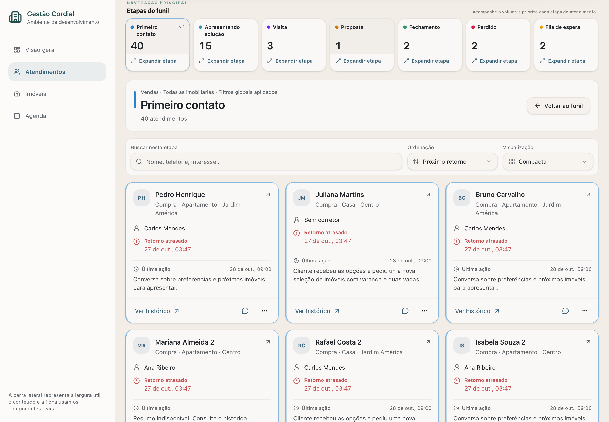
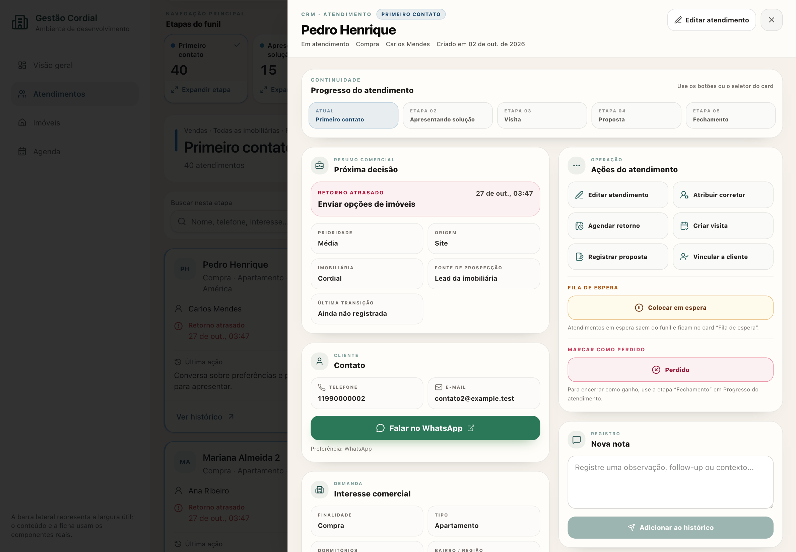
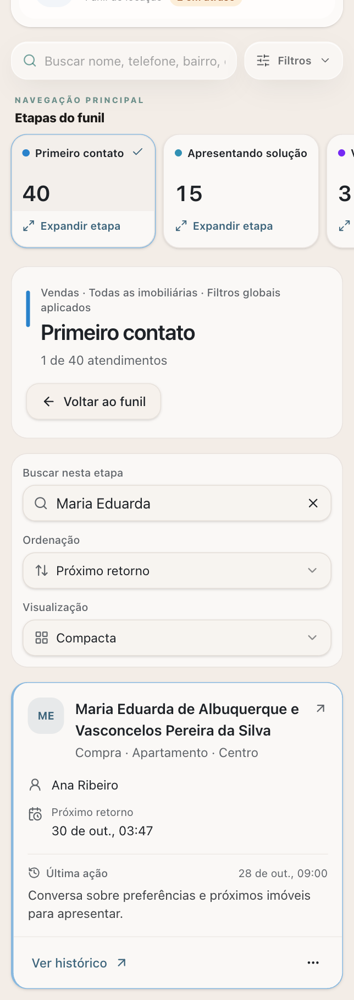

# Área de trabalho das etapas de Atendimentos

A expansão ocupa a região do CRM na própria página. As sete etapas continuam navegáveis no resumo superior, e a ficha individual continua sendo o `AtendimentoDetailDrawer`. A grade representa os atendimentos atualmente na etapa, depois dos filtros globais; não é uma análise de todos que já passaram pela etapa.

## Catálogo e variantes

| Componente                                    | Responsabilidade                                                   | Reuso                                                          |
| --------------------------------------------- | ------------------------------------------------------------------ | -------------------------------------------------------------- |
| `AtendimentoSummaryCards`                     | Seleção da etapa e ação irmã “Expandir etapa”, abaixo do contador  | Estendido; sete etapas canônicas e seleção explícita           |
| `AtendimentoStageExpandedView`                | Cabeçalho, busca local, ordenação, densidade, grade e estados      | Novo; reutiliza Button, Input, Select, Skeleton e EmptyState   |
| `AtendimentoCompactCard`                      | Identidade, interesse, responsável, retorno, última ação e acessos | Novo; reutiliza helpers de interesse, datas, atraso e WhatsApp |
| `AtendimentoDetailDrawer`                     | Ficha completa, histórico individual e ações existentes            | Reutilizado como ficha única da rota                           |
| `PipelineTrackSelector`, `AtendimentoFilters` | Trilha e recorte global                                            | Reutilizados, sem duplicação dentro da área expandida          |

As variantes de densidade são `compacta` (padrão, padding de 16 px, largura mínima de referência 290 px) e `confortavel` (padding de 20 px, largura mínima de referência 340 px). Ambas usam nome de 16 px e informações operacionais de 14 px. A grade usa `auto-fill`, respeita a largura útil e mantém um único card alinhado ao início sem esticá-lo por toda a tela.

Os componentes usam `background`, `card`, `border`, `foreground`, `muted-foreground`, `primary`, `destructive` e `ring` de `src/styles.css`. A identificação das etapas vem de `pipelineStageUi`; a cor de atraso vem de `destructive`, sem transformar uma etapa terminal inteira em alerta.

Os resumos de última ação servem apenas à consulta rápida. A consulta de histórico e o registro canônico da primeira abertura pertencem à ficha realmente aberta.

## Prévia isolada de desenvolvimento

O projeto já possui prévias Vite em `tests/marketing` e `tests/vistoria`. Esta entrega segue o mesmo padrão, sem instalar Storybook:

```sh
node node_modules/vite/bin/vite.js --config tests/atendimentos/vite.config.ts
```

Abra `http://127.0.0.1:5181/tests/atendimentos/preview.html`. A prévia monta a rota, o hook, os cards e a ficha reais. Somente autenticação, armazenamento global e funções remotas são substituídos por fixtures. Todas as importações de transportes `*.functions` são redirecionadas; a prévia não envia leads, notas, e-mails, eventos ou alterações para produção. A barra lateral da prévia representa uma largura de 272 px e não substitui o componente de navegação de produção.

O estado da rota usa o histórico de hash do navegador na prévia, permitindo testar recarga, voltar e avançar. Os parâmetros antes do hash controlam os dados fictícios:

| Parâmetro                         | Cenário                                                             |
| --------------------------------- | ------------------------------------------------------------------- |
| `count=0`, `1`, `15`, `40`, `500` | Quantidade da primeira etapa; padrão 40                             |
| `scenario=empty`                  | CRM inteiro sem atendimentos                                        |
| `initial=list`                    | Entrada na lista para testar retorno ao modo anterior               |
| `state=loading`                   | Primeira consulta demora cerca de 4,5 segundos                      |
| `state=error`                     | Primeira consulta falha; a tentativa seguinte pode recuperar        |
| `state=mutation-error`            | Movimentações falham sem persistir a alteração                      |
| `role=corretor`                   | Fixture retorna somente atendimentos atribuídos ao usuário fictício |
| `role=meta_reviewer`              | Fixture sem acesso a Atendimentos                                   |
| `sidebar=hidden`                  | Área sem a largura da barra lateral de demonstração                 |

O diagnóstico superior exibe quantidade de listagens, consultas de histórico, primeiras aberturas e alterações. Expandir ou buscar uma etapa deve manter histórico e primeira abertura em zero. Abrir uma ficha consulta somente o contato aberto. “Simular falha de atualização” permite verificar que os dados já carregados continuam visíveis.

Os dados incluem nomes longos e sem espaços, contatos sem telefone, sem corretor, sem retorno e sem resumo, retornos passados e futuros, etapas terminais e atendimentos associados ao mesmo cliente fictício. Nenhum registro fictício é inserido no banco.

## Roteiro de verificação visual

1. Conferir as sete ações de expansão e a seleção normal separada.
2. Confirmar os 40 da primeira etapa, os 15 da segunda e a navegação das etapas vazias.
3. Buscar e limpar, ordenar, alternar densidade e conferir “X de Y”.
4. Abrir uma ficha, consultar o histórico, fechar e conferir posição/foco; mover e conferir origem/destino.
5. Conferir recorte por cliente, trilha, imobiliária e filtros; recarregar, voltar e avançar.
6. Exercitar carregamento, erro inicial, erro de atualização e erro de movimentação.
7. Conferir 390, 768, 1280, 1440 e 1920 px, zoom de 200%, nomes longos e navegação por teclado.

Uma captura confirma somente o estado e a largura capturados. A prévia isolada não comprova RLS, limites ou desempenho da base de produção. Os resultados executados e as capturas devem acompanhar a PR; verificações não realizadas permanecem declaradas como limitações.

## Dados, navegação e arquivos

A rota continua coordenando filtros, permissões, mutações e uma única ficha. `modo=funil|lista|etapa`, `etapa` (somente as sete etapas) e `origem=funil|lista` são validados na URL; os parâmetros anteriores são preservados. A seleção normal mantém o comportamento de abrir o funil, enquanto expandir mantém a origem para o retorno. Uma etapa explícita prevalece sobre o deep link da ficha. A rolagem fica em um mapa em memória limitado a 24 posições; somente a densidade é persistida por usuário, sem copiar dados de contatos.

`stage-workspace.ts` deriva base, grupos e contagens depois do recorte `clienteId`, sobre a coleção já autorizada e filtrada pelo hook. As métricas próprias das trilhas permanecem com sua semântica anterior. Busca local e ordenação não alteram os filtros globais. A grade não possui cortes por quantidade.

A listagem anterior não explicitava paginação. `read-all-pages.ts` percorre ranges em ordem determinística até alcançar a contagem exata do mesmo escopo RLS, inclusive quando o servidor impõe um limite menor que o range solicitado. Falhas, duplicações e mudanças detectadas de quantidade rejeitam a resposta parcial. O histórico individual também é paginado, somente quando a ficha é aberta. Os resumos da listagem continuam limitados e são consultados em lotes de 100 identificadores.

`query-cache.ts` separa listagem, corretores e histórico por usuário. Hook, ficha, relatórios e consumidores compartilhados do dashboard usam o mesmo escopo. O rollback de uma movimentação desfaz somente o contato envolvido, preservando movimentações de outros contatos. Fechamento e perda no menu compacto encaminham à ficha existente, mantendo suas confirmações e permissões.

Arquivos centrais: `src/routes/_app.atendimentos.tsx`, `src/hooks/useAttendances.ts`, componentes de `src/components/atendimentos/`, seletores de `src/lib/atendimentos/`, paginação em `src/lib/attendances/` e os consumidores de cache do dashboard. `AppShell` remove o limite máximo de largura apenas na etapa expandida. Não há nova dependência, migração ou tabela.

## Verificações executadas em 28/10/2026

- **Typecheck:** `tsc --noEmit`, aprovado.
- **Testes pertinentes:** script `test:atendimentos`, 57 testes aprovados. Inclui agrupamento/contagem por cliente, busca normalizada, ordenação/estados terminais, paginação com 500 e 1.203 registros e limite simulado de 73 por página, escopo de cache, rollback e navegação com o TanStack Router instalado. O script foi executado com Node/tsx locais; o ambiente não tem Bun no PATH.
- **Lint dirigido:** rota, hook, novos componentes, resumo e seletores/paginação: zero erros e zero avisos.
- **Build de produção:** `vite build`, aprovado. Permanecem avisos existentes sobre `inputValidator` e tamanho de chunks.
- **Navegador interno:** rota/hook/ficha reais com transportes fictícios. Conferidos 0, 1, 15, 40 e 500 cards; sete acessos; busca “3 de 40” e limpeza; nome longo; ordenação por nome; duas densidades; ficha com histórico e primeira abertura somente do contato aberto; retorno de foco; movimento 40→39 e destino 15→16; reversão de falha; erro inicial com recuperação e erro de atualização mantendo dados.
- **Recortes e navegação:** cliente + imobiliária produziram quatro cards e contador quatro; troca para aluguel manteve a expansão com cinco cards; recarga preservou etapa; sequência de lista/expansão/retorno, voltar e avançar foi conferida com os controles nativos de histórico da prévia. Mover pela ficha manteve a ficha aberta e a etapa de origem selecionada.
- **Larguras CSS medidas:** 390 px → uma coluna; 768 → duas; 1280 e 1440 com sidebar de demonstração → três; 1920 → cinco. Sem overflow horizontal da página em todas essas larguras. A navegação de etapas possui rolagem horizontal própria no celular.

As capturas abaixo são imagens reais da prévia isolada, com contatos fictícios; a sidebar representa a largura disponível. A captura mobile mostra uma busca local para demonstrar a quebra de um nome longo. Os arquivos preservam a densidade de pixels nativa da captura; as larguras citadas são as larguras CSS do layout.







## Limitações materiais

Não houve sessão autenticada contra a aplicação/banco de produção. A revisão de autorização e paginação foi feita no código e nos testes; as fixtures não comprovam RLS real nem latência do banco. Os 500 cards foram renderizados no navegador sem corte; não foi realizado benchmark em aparelhos de baixo desempenho. Não foi executado zoom nativo de 200%, leitor de tela ou medição automatizada de contraste. As verificações de teclado cobriram abertura da ficha, menu de movimentação e devolução de foco, sem auditoria completa de toda a aplicação.
