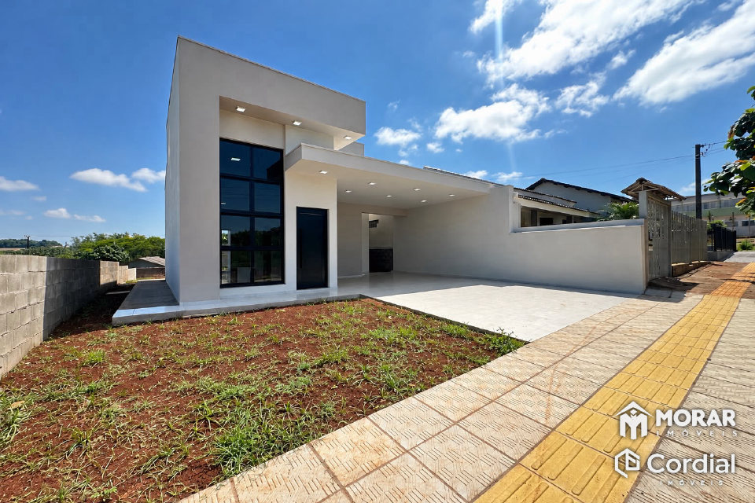
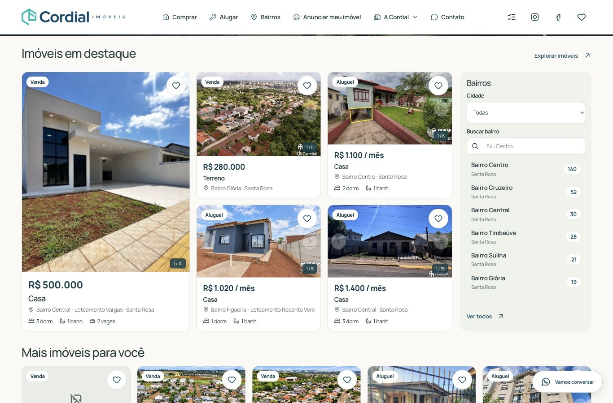
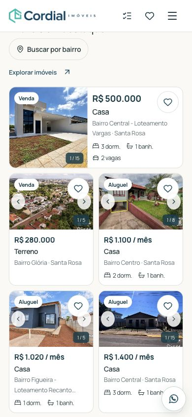
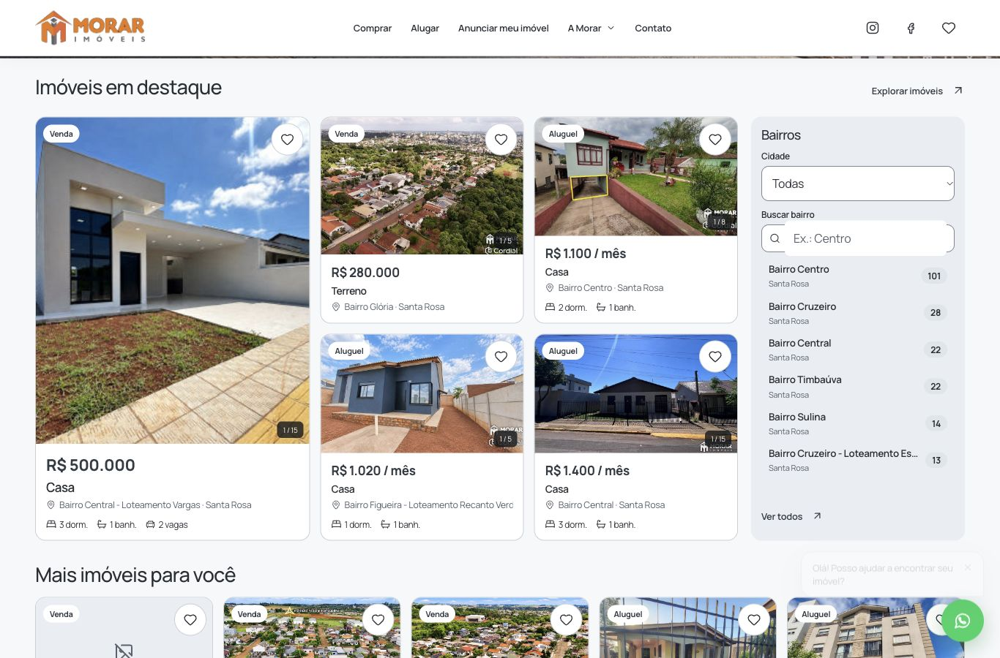
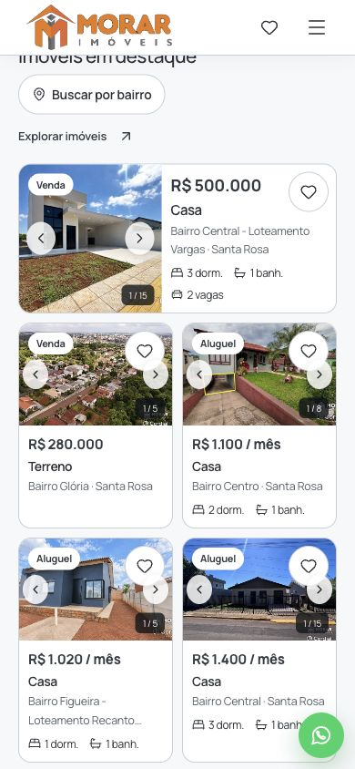

# Cinco destaques: navegação e tratamento fiel

## Comparação de navegação — 14/11/2026

O comparativo isola a navegação de fotos, usando o código publicado pela PR #45 como referência e o mesmo catálogo, fotos e atrasos de servidor nas duas versões. A edição semanal com IA estava inativa nesse ensaio: estes números não são medições da produção nem uma comparação de velocidade entre fotografias diferentes.

Cinco execuções por marca, versão e perfil: 40 aberturas e 800 trocas. Em cada abertura, o teste espera a foto principal, aguarda dois segundos, percorre os cinco destaques e faz quatro avanços por cartão, com 250 ms entre trocas concluídas. O tempo termina quando a nova imagem está carregada e começa a aparecer; não inclui os 140 ms completos da transição suave.

| Marca / perfil | Primeira troca do destaque principal, mediana antes → depois | Redução | p75 de todas as trocas antes → depois |
| --- | ---: | ---: | ---: |
| Cordial / desktop | 731 → 33 ms | 95,5% | 117 → 33 ms |
| Morar / desktop | 720 → 31 ms | 95,7% | 117 → 33 ms |
| Cordial / celular | 1.156 → 25 ms | 97,8% | 449 → 33 ms |
| Morar / celular | 1.187 → 26 ms | 97,8% | 484 → 33 ms |

Considerando a primeira troca de **cada um dos cinco cartões**, o p75 caiu de 899 para 33 ms na Cordial/desktop, de 914 para 32 ms na Morar/desktop, de 1.093 para 31 ms na Cordial/celular e de 1.081 para 32 ms na Morar/celular. A versão anterior já antecipava algumas vizinhas; por isso este indicador de cauda complementa a mediana do primeiro destaque.

Não houve quadro vazio nas 400 trocas da versão ajustada. A versão de referência também preservou a foto durante as trocas deste ensaio. A nova transição mantém o mesmo elemento de imagem anterior até a substituta estar pronta. A inversão rápida de direção foi conferida separadamente no navegador e por teste de interação: contador de volta em 1/15, uma imagem carregada e nenhuma camada antiga retida.

**Limite observado:** no celular, avançar em sequência até a quarta foto do primeiro destaque ainda alcançou uma imagem em download, com espera de até 1.166 ms. A primeira e a segunda troca ficaram preparadas; não existe promessa de latência zero para qualquer imagem ainda não transferida. Economia de dados desativa a antecipação automática e preserva a navegação manual.

### Condições e limites do ensaio

- Desktop: 1366 × 900, DPR 1, sem limitação de rede adicional; atrasos do serviço de imagens mantidos na simulação.
- Celular: 390 × 844, DPR 2, latência de 150 ms, download de 209.715 bytes/s e upload de 98.304 bytes/s (aproximadamente 1,6/0,75 Mbit/s).
- Fotos com cache frio: cada abertura recebe uma nova versão de mídia. Os arquivos estáticos da aplicação podem estar em cache. Não apresentar o ensaio como abertura integral com todo o cache do navegador apagado.
- Backend de laboratório com catálogo e galeria autorizados simulados. O fluxo usa os componentes e loaders reais, com build SSR e imagens locais fixas. Não mede distância até o armazenamento real, carga de produção nem CPU de um telefone físico.
- O recurso da foto principal terminou em medianas de 1.441 → 1.395 ms (Cordial/desktop), 1.446 → 1.396 ms (Morar/desktop), 2.443 → 2.472 ms (Cordial/celular) e 2.434 → 2.477 ms (Morar/celular). Isso é `ResourceTiming.responseEnd`, **não LCP nem uma medição de pintura visível**. Esta rodada prioriza as trocas, pois o usuário já aprovou o carregamento da página da PR #45.
- [Dados completos](evidence/featured-2026-11-14/benchmark.json) e [instrumentação das interações](evidence/featured-2026-11-14/benchmark-script.js).

## Funcionamento

Os metadados dos cinco destaques são enviados independentemente. Após a abertura, a preparação usa os mesmos `srcset` e `sizes` da imagem exibida. A fila permite até cinco preparações de destaques e reserva uma sexta vaga para cliques; a especulação do catálogo comum continua limitada. Um cartão que recebe interação passa à frente do trabalho de fundo. O cache decodificado é limitado a 32 entradas e 12 milhões de pixels.

A rotina semanal de tratamento usa a IA somente para escolher parâmetros limitados de exposição, sombras, contraste, saturação, temperatura e nitidez. O filtro é determinístico: não muda geometria, objetos, céu, materiais ou marcas d'água. Fotos já equilibradas recebem ajustes mínimos. Os originais permanecem intactos.

São preparados até cinco imóveis por marca e a capa mais as duas primeiras fotos seguintes de cada um, respeitando a galeria autorizada. A rotação prefere imóveis que não apareceram nas quatro semanas anteriores, completando com elegíveis quando o acervo é menor. Produz JPEGs de até 480, 960 e 1920 px sem ampliar uma fonte menor; o site público não executa IA nem tratamento de pixels durante visitas.

O preparo da próxima semana começa na sexta-feira às 18h, em São Paulo. A ativação ocorre na rotina horária a partir de segunda-feira às 6h, apenas quando o conjunto inteiro está pronto. A semana anterior permanece ativa enquanto isso. Os hooks existentes continuam autenticados por `internal_worker_headers()`; não foi criado um cron com chave pública. Cada execução processa no máximo uma foto por marca.

As imagens são privadas e separadas em `cordial-showcase` e `morar-showcase`. Os links públicos incluem o checksum do tratamento; cada resposta verifica marca, semana aprovada, versão e autorização atual da foto. A entrega valida o checksum dos bytes armazenados e revalida a autorização após o download. Uma retirada ou troca da mídia impede novas respostas, inclusive quando há bytes em memória no servidor.

O painel da vitrine mostra o progresso, permite pausar novos tratamentos e repetir o processamento de uma análise já salva. Uma resposta incerta da IA não é reenviada automaticamente. A vitrine generativa da abertura continua no seu fluxo de aprovação existente; esta autorização se limita ao tratamento fotométrico fiel dos cinco cartões.

## Migração e aplicação inicial

Migração Drizzle `0094_weekly_featured_photo_treatment`, gerada pelo Drizzle Kit, validada no PostgreSQL de testes e em transação revertida no Gestão Cordial. Aplicada pelo conector Lovable e registrada em `drizzle.__drizzle_migrations` com timestamp `1794629443437` e SHA-256 `64da6b473466f6ef981d85a749ce49914e7c53caffb7e441c910c4a259e87863`.

O pedido do usuário autoriza o tratamento fiel semanal e a aplicação aos destaques atuais. Os lotes foram fixados nos imóveis que estavam na home:

- Cordial: referências 1441, 1442, 1438, 1437 e 1436 — lote `71049acb-2981-4aba-afb6-5b8ca6e75039`.
- Morar: referências 3439, 3440, 3436, 3435 e 3434 — lote `a3b09ce0-8907-4ff3-8426-31d2739b1f19`.

Os dois lotes foram ativados atomicamente em 14/11/2026 às 05:10 UTC (02:10 em São Paulo). Cada RPC pública autorizada confirmou cinco imóveis e 15 fotos: 30 tratamentos prontos, uma análise por foto, sem falhas ou reenvios. Os 90 arquivos foram baixados no ambiente seguro do Lovable; todos os tamanhos em bytes e SHA-256 conferem com os registros. A conferência visual comparou os três originais do piloto com as respectivas versões tratadas; os demais passaram pela verificação de integridade, proporções e limites dos parâmetros. [Registro sanitizado da aplicação](evidence/featured-2026-11-14/treatment-audit.json).

A migração e os tratamentos estão aplicados no banco de produção. A rotina semanal e a entrega pública dessas versões dependem da publicação do código da PR; ativação no banco, isoladamente, não altera o código dos sites que já está publicado.

Exemplo da capa da referência 1441: sombras discretamente abertas, conteúdo e marcas de uso preservados. O original abaixo tem 1536 × 1024 px; a amostra tratada usa a variante de cartão de 960 × 640 px.

## Validação do código

`typecheck`, `test:site` (200 testes), `test:morar` (35 testes) e build de produção. A cobertura inclui respostas fora de ordem, cliques durante metadados pendentes, inversão rápida de direção, troca de imóvel, falha de imagem, economia de dados, limites da fila/cache, dependências opcionais lentas, retirada após download, isolamento entre marcas, leases, resposta incerta da IA sem repetição e ativação SQL completa/atômica.

## Capturas do layout com as fotos reais

Estas capturas usam os componentes da PR em prévia local de leitura, com o catálogo público real. Foram feitas antes da ativação do tratamento de IA.

